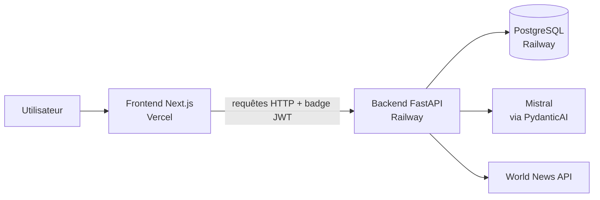

# Architecture de NewsFoundry

NewsFoundry aide les journalistes pigistes à préparer leurs revues de presse.
L'utilisateur discute avec une IA qui connaît l'actualité du jour, peut chercher des articles
récents, puis génère une revue de presse structurée à partir de la discussion.

## Application en ligne

| Partie | Hébergement | URL |
|---|---|---|
| Frontend | Vercel | https://projet-14-beta.vercel.app |
| Backend (API) | Railway | https://projet-14-production.up.railway.app |
| Documentation de l'API (Swagger) | Railway | https://projet-14-production.up.railway.app/docs |

## Vue d'ensemble



- Le **frontend** affiche l'interface et envoie les demandes au backend, avec le badge JWT de l'utilisateur.
- Le **backend** vérifie le badge, lit et enregistre les données dans **PostgreSQL**, appelle le LLM **Mistral** (avec **PydanticAI**) et récupère les articles avec **World News API**.

## Structure des dossiers

Le projet est un **monorepo** : le frontend et le backend sont dans le même dépôt Git.

Les fichiers sont présentés dans l'ordre du fonctionnement (en commençant par `main.py`, le point d'entrée du backend, qui importe tous les autres), et non dans l'ordre alphabétique de l'éditeur.

```
projet-14/
├── .github/workflows/tests.yml   # CI : lance les tests backend à chaque push sur main
├── docs/                         # cette documentation
├── backend/                      # l'API (Python)
│   ├── Dockerfile                # image utilisée par Railway
│   ├── pyproject.toml            # dépendances Python (gérées avec uv)
│   ├── src/
│   │   ├── main.py               # crée l'application FastAPI, active le CORS, branche les routes
│   │   ├── database.py           # connexion PostgreSQL, init_db() au démarrage, get_session()
│   │   ├── models.py             # les tables : User et Chat
│   │   ├── schemas.py            # la forme des données échangées (Pydantic)
│   │   ├── auth.py               # mots de passe, création et vérification du badge JWT
│   │   ├── news.py               # appels à World News API (top-news et search-news)
│   │   ├── agent.py              # l'agent du chat : prompt, actualités du jour, outil de recherche
│   │   ├── review_agent.py       # l'agent revue de presse (sortie structurée)
│   │   └── routes/
│   │       ├── auth_routes.py    # POST /login
│   │       ├── chat_routes.py    # les routes /chats
│   │       └── review_routes.py  # les routes de la revue de presse
│   └── tests/
│       ├── conftest.py           # préparation : base SQLite en mémoire, utilisateurs Alice et Bob
│       ├── test_auth.py          # tests du login
│       ├── test_chats.py         # tests du chat, de la sécurité, des actualités et de l'outil
│       └── test_reviews.py       # tests de la revue de presse
└── frontend/                     # l'interface (Next.js, JavaScript)
    ├── app/
    │   ├── layout.js             # la structure commune à toutes les pages
    │   ├── page.js               # la page principale : colonne de gauche + onglets Chat / Revue de presse
    │   └── login/page.js         # la page de connexion
    ├── components/
    │   ├── Sidebar.js            # la colonne de gauche : logo, liste des discussions, déconnexion
    │   ├── ChatWindow.js         # la zone de chat : messages, envoi, bouton « Générer une revue de presse »
    │   ├── ReviewModal.js        # la fenêtre pour choisir le thème de la revue
    │   └── ReviewsList.js        # la page des revues de presse
    └── lib/api.js                # apiFetch : envoie les demandes au backend avec le badge
```

## Les données

Deux tables dans PostgreSQL (fichier `backend/src/models.py`) :

| Table | Colonnes principales |
|---|---|
| `user` | `id`, `email`, `hashed_password` |
| `chat` | `id`, `user_id` (à qui appartient la discussion), `messages` (historique en JSON), `system_prompt` (prompt avec les actualités du jour), `created_at`, et la revue de presse : `review_title`, `review_synthesis`, `review_articles` (JSON), `review_created_at` |

Les articles ne sont pas stockés dans une table à part : ils viennent de World News API et sont
gardés dans les discussions (prompt, historique) et dans la revue de presse.

## Les routes de l'API

Toutes les routes, sauf `/login`, demandent le badge JWT dans l'en-tête `Authorization: Bearer <badge>`.

| Méthode | Route | Rôle |
|---|---|---|
| POST | `/login` | vérifie l'email et le mot de passe, renvoie le badge JWT |
| POST | `/chats` | crée une discussion (avec les actualités du jour dans son prompt) |
| GET | `/chats` | liste mes discussions, la plus récente en premier |
| GET | `/chats/{chat_id}` | lit une discussion (404 si elle n'est pas à moi) |
| POST | `/chats/{chat_id}/messages` | envoie un message, l'IA répond |
| POST | `/chats/{chat_id}/review` | génère la revue de presse de la discussion sur un thème |
| GET | `/reviews` | liste toutes mes revues de presse |

## Le parcours d'un message

1. Le frontend envoie le message avec `POST /chats/{chat_id}/messages` et le badge.
2. Le backend vérifie le badge (`get_current_user_id`) et que la discussion appartient à l'utilisateur.
3. Il donne à l'agent tout l'historique de la discussion. Au premier message, l'historique commence par le prompt système enregistré avec la discussion (rôle, règles et actualités du jour).
4. Si l'utilisateur veut approfondir un sujet, l'agent peut appeler son outil `rechercher_articles`, qui interroge World News API.
5. Le backend enregistre le nouvel historique dans la base et renvoie la réponse.

## Les deux agents

| Agent | Fichier | Rôle | Outil | Sortie |
|---|---|---|---|---|
| `chat_agent` | `agent.py` | discuter et chercher des articles | `rechercher_articles` | texte libre (Markdown) |
| `review_agent` | `review_agent.py` | rédiger la revue de presse à partir de la discussion | aucun | formulaire `PressReview` (titre, synthèse, articles) |

Les deux utilisent le même modèle : `mistral-small-latest`.
